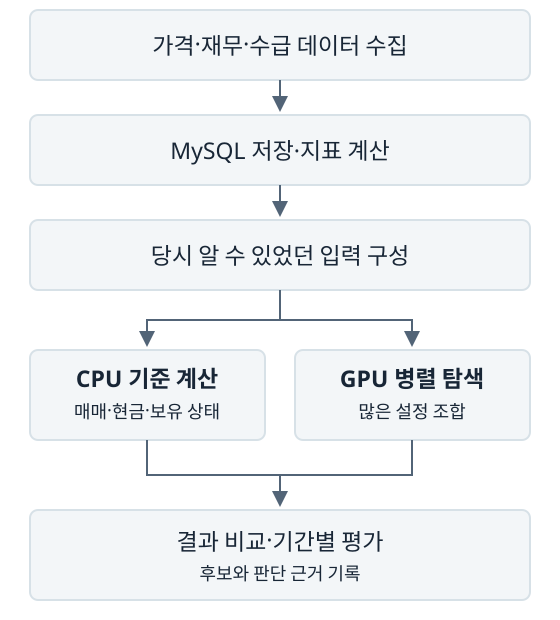

# 국내 주식 분할투자 시뮬레이터

**Split Investment Strategy Optimizer**

[](https://github.com/Lee-Ju-Yeong/Split_Investment_Strategy_Optimizer/actions/workflows/cpu-checks.yml)

주식을 여러 차례 나누어 사고파는 분할투자 전략을 국내 주식의 과거 데이터로 시험하고, 매수·매도 조건을 비교하는 개인 프로젝트입니다.

Python으로 데이터를 수집·정리하고 MySQL에 저장합니다. CPU 시뮬레이션을 결과 검증의 기준으로 삼고, GPU로 여러 설정 조합을 병렬 계산합니다. 이후 기간을 나누어 특정 과거 구간에서만 좋은 결과가 나온 것은 아닌지 검토합니다.

**직접 맡은 범위:** 프로젝트의 설계·구현·테스트·운영을 주도했습니다. 아래 사례에서 실제 코드와 테스트, 변경 이유를 확인할 수 있습니다.

## 먼저 볼 구현 사례

| 사례 | 해결한 문제 | 확인할 내용 |
| --- | --- | --- |
| [수집 중 일부 실패 처리](docs/engineering-evidence.md#collection) | 긴 수집 작업 중 일부 요청이 실패하는 상황 | 성공한 데이터 보존, 실패 집계, 재실행 범위 관리 |
| [데이터 반영 시점 검증](docs/engineering-evidence.md#availability) | 당시 알 수 없던 정보가 과거 계산에 들어가는 문제 | 지연 반영 규칙, 회귀 테스트, 변경 영향 분석 |
| [GPU 계산 시간 개선](docs/engineering-evidence.md#gpu) | 반복 계산에서 시간이 많이 걸리는 구간 | 구간별 측정, 개선 전후 비교, CPU 결과와의 일치 검사 |

각 사례는 **문제 → 판단과 구현 → 테스트 → PR·측정 기록** 순서로 읽을 수 있습니다. 실패한 수집을 재개하는 방법, 데이터가 사용되는 시점의 정확성, 측정에 근거한 계산 개선을 차례로 확인하세요.

설치 없이 먼저 살펴보려면 [가상 종목의 매수부터 매도까지](tests/README.md#cpu-example) 또는 [여섯 행으로 보는 데이터 반영 결과](tests/README.md#example)를 읽을 수 있습니다.

## 데이터와 계산 흐름



**데이터 수집 → MySQL 저장 → 당시 사용할 수 있었던 데이터로 입력 구성 → CPU·GPU 계산 → 결과 검증**

- **수집·저장:** 가격·거래량, 재무·수급·공매도 데이터와 과거 상장 종목 이력을 수집합니다. 종목별 지표를 미리 계산해 반복 조회 비용을 줄입니다.
- **CPU:** 매매 과정과 현금·보유 상태를 계산하는 기준 구현입니다.
- **GPU:** 많은 설정 조합을 병렬 계산하는 탐색 구현입니다.
- **검증:** CPU·GPU 결과를 비교하고, 기간을 나누어 후보를 평가합니다. 그날 알 수 없었던 정보를 미리 사용하는 오류를 막는 규칙과 테스트를 둡니다.

프로젝트 범위는 과거 데이터 시뮬레이션과 검증입니다. 완료된 구현, 당시 측정 결과, 후속 연구는 구분해서 기록합니다.

## 직접 확인하기

외부 계정·DB·GPU 없이 **기존 CPU 분할투자 구현**을 실행할 수 있습니다. 가상 종목 하나와 7거래일로 신규 매수 → 추가 매수 → 두 차례 매도 → 전액 현금 상태를 재현합니다. 패키지 설치에는 인터넷이 필요합니다.

```bash
# Python 3.12, 저장소 루트에서 실행
python3.12 -m venv .venv
source .venv/bin/activate
python -m pip install -r requirements-review.txt
python -m pip check

python -m examples.cpu_split_demo
# 선택: 결과를 새 디렉터리에 CSV 두 개로 저장
python -m examples.cpu_split_demo --output-dir results/cpu-split-demo

# 예제와 관련 CPU 검사를 CI와 같은 명령으로 확인
python tools/ci/run_cpu_checks.py
```

CPU 예제는 실제 엔진·전략·체결·자산 계산을 사용합니다. 가상 입력의 검증 결과는 거래 4건, 최종 현금·자산 1,020,551원, 수수료 60원·세금 389원입니다. 결과를 고정 기대값과 대조한 뒤 성공을 표시합니다. 사전 구성한 가상 가격·지표·등급으로 계산하며 실제 투자 성과나 데이터 수집·SQL·GPU 전체 검증을 뜻하지 않습니다.

**이번 단계의 완료 범위는 가상 데이터로 CPU 분할투자 과정을 끝까지 재현하는 것**입니다. [완료 범위와 실제 검사 근거](todos/done_2026_11_06-cpu-split-demo.md)를 남겼으며 GPU 환경·전체 데이터 실행 등은 후속 과제로 구분합니다.

기존 `python -m examples.short_selling_lag_demo`는 **1월 2일 기준 데이터가 세 거래일 뒤인 1월 5일에 반영되는 과정**을 별도로 보여줍니다.

- [처음 설치하기·예상 출력·기존 테스트 실행](tests/README.md)
- [전체 실행에 필요한 환경과 설정](docs/running.md)
- [문서 안내](docs/README.md)
- [진행 상태와 개발 기록](TODO.md)

## 구현 상태와 확인 범위

제품 계산 구현의 기준은 2026-03-31 병합된 [PR #106](https://github.com/Lee-Ju-Yeong/Split_Investment_Strategy_Optimizer/pull/106)입니다. 이후 2026-11-06에 소개·예제·자동 검사를 정비했습니다. 최신 문서·CI 커밋이 새 투자 전략이나 GPU 성능 개선을 의미하지는 않습니다.

| 항목 | 확인된 상태 | 남은 확인·연구 |
| --- | --- | --- |
| 수집 재개·부분 실패 처리 | [PR #100](https://github.com/Lee-Ju-Yeong/Split_Investment_Strategy_Optimizer/pull/100)에 구현·테스트 반영 | 현재 외부 데이터 제공처의 접속 조건은 실행 환경에서 확인 필요 |
| GPU 계산 시간 개선 | [PR #103](https://github.com/Lee-Ju-Yeong/Split_Investment_Strategy_Optimizer/pull/103), [PR #105](https://github.com/Lee-Ju-Yeong/Split_Investment_Strategy_Optimizer/pull/105) 완료 | 공개 수치는 당시 특정 입력의 측정 기록이며 이번에 GPU 재측정하지 않음 |
| 공매도 지연 반영 | 임시 3거래일 정책·회귀 테스트·영향 비교 도구 구현 | 장기 데이터 재계산 전체 완료는 공개 기록으로 확인되지 않음 |
| 기간을 나눈 전략 검증(WFO) | 후보 목록 고정, CPU 검산, 최종 평가 전 조건 검사, 후보 압축 도구 구현 | 구현 완료와 전략의 최종 승인·실전 유효성은 별도 판단 |
| 군집화·k3s/GPU 작업 운영 | 연구·설계 문서 보유 | 기본 운영 기능이나 배포 완료 성과로 소개하지 않음 |

자동 검사별 확인 범위를 구분합니다. 각 실행의 요약에서 후보 커밋·환경·실제 검사 수를 확인할 수 있습니다.

| 자동 검사 | 확인하는 범위 | 실행 기록 |
| --- | --- | --- |
| CPU 기본 검사 | 기존 34개·관련 CPU 18개·새 예제 검사 20개 = 72개와 예제 2개, 실행 도구 자체 24개. 누락·건너뜀도 실패 | [CPU checks](https://github.com/Lee-Ju-Yeong/Split_Investment_Strategy_Optimizer/actions/workflows/cpu-checks.yml) |
| 격리 DB 통합 검사 | 매번 새 MySQL의 합성 CPU 시나리오 3개, 연결 제한·실패 처리 14개 | [DB integration](https://github.com/Lee-Ju-Yeong/Split_Investment_Strategy_Optimizer/actions/workflows/db-integration.yml) |
| 문서 화면 검사 | Jekyll 생성·주요 링크·한국어 정보·넓은/좁은 화면·키보드 탐색 | [Docs preview](https://github.com/Lee-Ju-Yeong/Split_Investment_Strategy_Optimizer/actions/workflows/docs-preview.yml) |

비밀정보 검사(Secret Scan)와 기존 Pages 배포도 유지합니다. 위 결과는 운영 DB·외부 수집·GPU 전체 검증이나 투자 성과를 뜻하지 않습니다. [검사별 준비·실행·제외 범위](tests/README.md)와 [정비 결과](todos/2026_11_06-project-maintenance-execution.md)를 함께 확인할 수 있습니다.

## 코드 찾아보기

[src/ 코드 읽기 안내](src/README.md)에서 실제 구현과 관련 테스트의 추천 순서를 확인할 수 있습니다.

| 관심 있는 부분 | 시작점 |
| --- | --- |
| 수집 실패·재실행 처리 | [공매도 수집기](https://github.com/Lee-Ju-Yeong/Split_Investment_Strategy_Optimizer/blob/main/src/short_selling_collector.py) |
| 데이터 저장 구조 | [스키마 설명](docs/database/schema.md) |
| CPU 매매·자산 상태 | [CPU 구현](https://github.com/Lee-Ju-Yeong/Split_Investment_Strategy_Optimizer/tree/main/src/backtest/cpu) |
| GPU 병렬 계산 | [GPU 엔진](https://github.com/Lee-Ju-Yeong/Split_Investment_Strategy_Optimizer/blob/main/src/backtest/gpu/engine.py) · [매매 계산](https://github.com/Lee-Ju-Yeong/Split_Investment_Strategy_Optimizer/blob/main/src/backtest/gpu/logic.py) |
| 후보 평가·결과 추적 | [분석 도구](https://github.com/Lee-Ju-Yeong/Split_Investment_Strategy_Optimizer/tree/main/src/analysis) |
| 기존 동작을 확인하는 검사 | [tests](https://github.com/Lee-Ju-Yeong/Split_Investment_Strategy_Optimizer/tree/main/tests) |

`src/pipeline_batch.py` 같은 최상위 실행 파일은 기존 명령을 유지하기 위한 진입점입니다. 실제 구현 위치는 [경로 안내](docs/refactoring/issue69-import-path-mapping.md)에서 확인할 수 있습니다. `notebook/`과 `llm-context/`는 과거 연구·설계 자료이며, 현재 실행 순서는 위 안내를 따릅니다.

[문서 사이트](https://lee-ju-yeong.github.io/Split_Investment_Strategy_Optimizer/)는 이 저장소 문서를 게시합니다. 유지보수자: [Lee-Ju-Yeong](https://github.com/Lee-Ju-Yeong).
